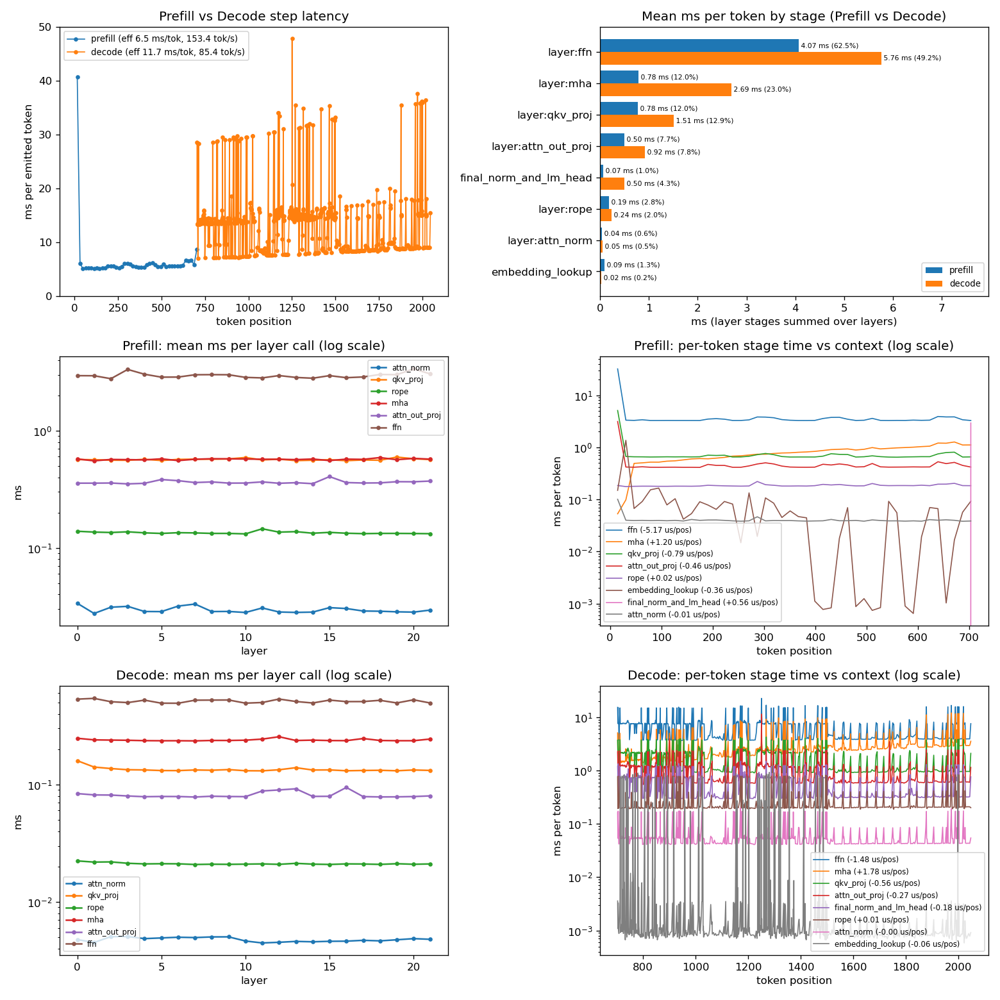

# nanoinfer

> **Big models. Tiny footprint. Zero dependencies.**

`nanoinfer` is a bare-metal, pure C++ LLM inference engine and GGUF parser built from first principles. It loads multi-gigabyte models directly from disk via memory-mapping (`mmap`), parses raw GGUF binary formats, and executes custom quantization kernels with zero external libraries.

---

## Features

- **Zero External Dependencies**: Built entirely with standard C++17 and POSIX system calls (`mmap`, `munmap`). No PyTorch, no llama.cpp, no third-party runtimes.
- **Zero-Copy Memory-Mapped I/O**: Maps model weights directly into virtual memory. Instant startup time and minimal RAM overhead even for large models.
- **Full GGUF v2/v3 Parser**:
  - Binary header and magic number validation
  - Arbitrary metadata key-value parser (strings, arrays, integers, floats, booleans)
  - Tensor directory extraction with dimension and byte offset calculation
- **Custom Dequantization Kernels**:
  - **`Q8_0`**: 32-weight blocks with 16-bit float scales (~3.7× compression vs. F32)
  - **`Q4_K`**: 256-weight super-blocks with packed sub-block scales and 4-bit nibbles (~7× compression vs. F32)
  - **`F16` to `F32`**: Bitwise IEEE 754 half-precision float expansion

---

## Project Structure

```text
nanoinfer/
├── model_loader.h      # GGUF header, tensor structures, and model loading API
├── model_loader.cpp    # mmap file loading, metadata parsing, tensor indexer
├── dequant.h           # Block structures (BlockQ8_0, BlockQ4_K) and dequant signatures
├── dequant.cpp         # Bit-manipulation and scale expansion routines
├── model_test.cpp      # Verification CLI for tensor inspection & dequant testing
├── Makefile            # Build configuration (clang++ -O3)
└── .gitignore
```

---

## Getting Started

### Prerequisites

A modern C++ compiler supporting C++17 (e.g. `clang++` or `g++`) and `make`.

### Build

```bash
make
```

This compiles the `model_test` binary with `-O3` optimizations.

### Run

Point the binary to any GGUF model file:

```bash
./model_test path/to/model.gguf
```

Example output:
```text
=== GGUF Header ===
magic:               0x46554747 (GGUF)
version:             3
tensor_count:        291
metadata_kv_count:   24

--- F32 tensor: blk.0.attn_norm.weight ---
first 5 values (direct, no dequant needed): 0.402344 0.380859 0.412109 ...

--- Q4_K tensor: blk.0.attn_q.weight ---
dims: [4096, 4096]
first 10 dequantized weights: -0.012451 0.003906 -0.021484 ...
```

---

## Performance & Benchmarks

Measured on Apple Silicon (Apple M3, ARM NEON SDOT `vdotq_s32`, dynamic work-stealing thread pool, 6 threads) running **TinyLlama 1.1B (`Q4_K_M`)** across the full **2,048 context window** (`prompts/prompt_code_500.txt`: 704 prefill tokens in batches of $B=16$, followed by 1,344 decode tokens generated with 3-gram speculative decoding $B \le 4$ and an asymmetric **`Q8_0` $K$ + `FP16` $V$** quantized KV cache):

- **Batched Prefill Throughput:** **~5.41 ms/token** effective (**~184.7 tokens/sec**, `3,810.8 ms` total across 44 chunks of $B=16$; up to **199.1 tokens/sec** / **5.02 ms/tok** on warmed-up 64-token prefill) using 4-token register-blocked NEON GEMM (`matmul_q4_k` / `matmul_q6_k`), achieving up to **~458 GFLOP/s** and a **~2.4× speedup** over sequential single-token prefill.
- **Speculative Decode Latency (`NANO_SPEC_K=3`, $B \le 4$, Asymmetric `Q8_0` $K$ + `FP16` $V$ Cache):**
  - On `prompts/prompt_code_500.txt` (1,344 decode tokens): **11.56 ms/emitted_tok** (**86.5 tokens/sec**, `15,541 ms` across 687 steps vs. `18,880 ms` with `float32` KV cache and `22,814 ms` at $B=1$; **73.5% draft acceptance**, `1.96 tok/step`, **9.83 ms/hw_tok**, `85.0%` useful hardware work).
  - On `prompts/prompt_500.txt` (1,399 decode tokens): **9.35 ms/emitted_tok** (**106.9 tokens/sec**, `13,086 ms` across 440 steps vs. `15,862 ms` with `float32` KV cache and `23,005 ms` at $B=1$; **81.9% draft acceptance**, `3.18 tok/step`, **8.12 ms/hw_tok** — **1.76× speedup** over $B=1$ and **~111× speedup** over the `1041 ms/tok` naive baseline).
- **Asymmetric Quantized KV Cache (`35.3 MB` vs. `92.2 MB` `float32`):**
  - **`k_cache` in `BlockQ8_0` (`12.25 MB`, `3.76×` compression):** Keeps 64 `int8` query elements pinned in 4 NEON registers and computes horizontal `Q · K` inner products via 4 single-cycle `vdotq_s32` (`SDOT`) instructions per token position.
  - **`v_cache` in `FP16` (`23.04 MB`, `2.0×` compression):** Preserves per-element floating-point exponents along the vertical `Attn · V` accumulation axis and converts 4 lanes per cycle via hardware `vcvt_f32_f16`, cutting total `layer:mha` decode time by **42.1%** (`6,243 ms` $\rightarrow$ `3,613 ms`, p50 per-layer latency `0.258 ms` $\rightarrow$ **`0.132 ms`**) with 100% greedy token parity on `compare_greedy.py`.
- **DRAM Allocation per Token:** **0 bytes** (fused in-register quantized GEMV / GEMM).

### Profiling Analysis (704 Prefill Tokens + 1,344 Speculative Decode Tokens across 2,048 Context)



### Per-Emitted-Token Stage Breakdown: Prefill ($B=16$, 704 tokens) vs. Speculative Decode ($B \le 4$, 1,344 emitted tokens / 687 steps)

| Stage (summed over 22 layers) | Prefill (`ms/tok`) | Prefill Share | Spec Decode (`ms/tok`) | Decode Share | Notes |
| :--- | :---: | :---: | :---: | :---: | :--- |
| `layer:ffn` (SwiGLU `Q4_K` / `Q6_K`) | **3.31 ms** | 61.2% | **5.72 ms** | 49.5% | Reduced from `8.30 ms/tok` at $B=1$ via 4-token weight reuse |
| `layer:mha` (Asymmetric `Q8_0` K + `FP16` V) | **0.80 ms** | 14.7% | **2.69 ms** | 23.2% | Reduced by **42.1%** (from `4.64 ms/tok` in `float32`) via `SDOT` + `FP16` |
| `layer:qkv_proj` (`Q4_K` / `Q6_K`) | **0.66 ms** | 12.2% | **1.47 ms** | 12.7% | Reduced from `2.29 ms/tok` at $B=1$ |
| `layer:attn_out_proj` (`Q4_K`) | **0.42 ms** | 7.7% | **0.88 ms** | 7.6% | Reduced from `1.26 ms/tok` at $B=1$ |
| `final_norm_and_lm_head` (`Q6_K`) | **0.002 ms** | 0.0% | **0.50 ms** | 4.3% | Reduced from `0.80 ms/tok` at $B=1$ (`matmul_tensor`) |
| `layer:rope` | **0.18 ms** | 3.4% | **0.24 ms** | 2.1% | Rotary Position Embeddings |
| `layer:attn_norm` | **0.04 ms** | 0.7% | **0.05 ms** | 0.5% | RMSNorm |
| `embedding_lookup` | **0.001 ms** | 0.0% | **0.001 ms** | 0.0% | Single-row dequantization |
| **Total Effective (`total_ms / emitted_tokens`)** | **5.41 ms/tok** | **184.7 tok/s** | **11.56 ms/tok** | **86.5 tok/s** | `9.83 ms/hw_tok` across `1,581` hardware tokens (`85.0%` useful) |

### Raw Probe Summary (from `probe.csv`)

| Component / Stage | Phase | Samples | Total (`ms`) | Mean (`ms`) | p50 (`ms`) | p99 (`ms`) | Notes |
| :--- | :--- | :--- | :--- | :--- | :--- | :--- | :--- |
| `prefill_total` | `prefill` | 1 | **3810.78 ms** | **3810.78 ms** | **3810.78 ms** | 3810.78 ms | Full 704-token prompt prefill (`5.41 ms/tok` eff) |
| `prefill:forward_token` | `prefill` | 44 | **3810.77 ms** | **86.61 ms** | **86.93 ms** | 100.20 ms | Per 16-token prefill batch (~184.7 tok/s) |
| `decode:forward_token` | `decode` | 687 | **15541.23 ms** | **22.62 ms** | **14.86 ms** | 38.03 ms | 687 steps emitting 1,344 tokens (`11.56 ms/tok` eff) |
| `all_layers` | `decode` | 687 | **14863.74 ms** | **21.64 ms** | **14.07 ms** | 36.62 ms | 22 transformer layers combined ($B \in \{1..4\}$) |
| ├── `layer:ffn` | `decode` | 15,114 | **7690.83 ms** | **0.509 ms** | **0.366 ms** | 0.845 ms | SwiGLU FFN (`Q4_K` / `Q6_K` SDOT GEMV/GEMM) |
| ├── `layer:mha` | `decode` | 15,114 | **3613.30 ms** | **0.239 ms** | **0.132 ms** | 0.613 ms | Asymmetric `Q8_0` K (`SDOT`) + `FP16` V (`vcvt_f32_f16`) |
| ├── `layer:qkv_proj` | `decode` | 15,114 | **1976.90 ms** | **0.131 ms** | **0.107 ms** | 0.216 ms | Q, K, V projections |
| ├── `layer:attn_out_proj` | `decode` | 15,114 | **1186.71 ms** | **0.079 ms** | **0.059 ms** | 0.132 ms | Attention output projection |
| ├── `layer:rope` | `decode` | 15,114 | **320.68 ms** | **0.021 ms** | **0.010 ms** | 0.040 ms | Rotary Position Embeddings |
| └── `layer:attn_norm` | `decode` | 15,114 | **71.43 ms** | **0.005 ms** | **0.003 ms** | 0.008 ms | RMSNorm |
| `final_norm_and_lm_head`| `decode` | 687 | **674.95 ms** | **0.982 ms** | **0.770 ms** | 1.594 ms | Batch RMSNorm + Vocab projection (`Q6_K` SDOT) |
| `embedding_lookup` | `decode` | 687 | **1.82 ms** | **0.003 ms** | **0.003 ms** | 0.007 ms | Batch single-row dequantization |
| `decode:argmax` | `decode` | 1,345 | **77.77 ms** | **0.058 ms** | **0.022 ms** | 0.118 ms | Greedy token verification |

### Work Done (`batch_tokens`) vs. Meaningful Work (`emitted_tokens`)

| Benchmark Prompt | Prompt / Decode | Steps | Hardware Tokens ($B$) | Emitted Tokens ($E$) | Draft Acceptance | `ms / hw_tok` | Effective `ms / tok` | Effective Throughput |
| :--- | :---: | :---: | :---: | :---: | :---: | :---: | :---: | :---: |
| `prompts/prompt_code_500.txt` | 704 / 1,344 | 687 | 1,581 | 1,344 (85.0% useful) | **73.5%** (657 / 894) | 9.83 ms | **11.56 ms/tok** | **86.5 tok/s** |
| `prompts/prompt_500.txt` | 649 / 1,399 | 440 | 1,611 | 1,399 (86.8% useful) | **81.9%** (959 / 1,171) | 8.12 ms | **9.35 ms/tok** | **106.9 tok/s** |

To reproduce these metrics and generate the plots on your machine:
```bash
# Run full 2,048-context generation with the 704-token C++ systems prompt
NANO_IGNORE_EOS=1 NANO_PROMPT_FILE=prompts/prompt_code_500.txt NANO_N=2000 ./model_test ../llama.cpp/models/tinyllama.gguf

# Plot both prefill and decode probe results side-by-side
python3 tools/plot_probe.py probe.csv --phase both -o probe.png

# Benchmark batched prefill across B in {1, 2, 4, 8, 16, 32, 64}
python3 tools/bench_prefill.py -m ../llama.cpp/models/tinyllama.gguf
```

---

## Roadmap

- [x] Fast GGUF binary parser with `mmap`
- [x] Custom dequantization routines (`Q8_0`, `Q4_K`, `Q6_K`, `F16`)
- [x] Attention mechanism (GQA), RoPE, and KV Cache
- [x] Tokenizer (SentencePiece / BPE)
- [x] End-to-end autoregressive text generation
- [x] Single-row embedding lookup optimization (20.5 ms -> 0.09 ms)
- [x] ARM NEON SDOT (`vdotq_s32`) fused quantized GEMV for `Q4_K` and `Q6_K`
- [x] In-register NEON scale accumulation (1 horizontal `vaddvq_s32` reduction per 256-weight super-block)
- [x] Fused `gate` + `up` projections (saving 22 thread sync barriers per step)
- [x] Dynamic atomic work-stealing thread pool with QoS across heterogeneous cores
- [x] Fused multithreaded NEON Multi-Head Attention kernel (`mha_decode`)
- [x] 4-token activation register-blocked NEON GEMM (`matmul_q4_k`, `matmul_q6_k`) and batched `forward_batch` prefill
- [x] Speculative decoding (3-Gram Prompt-Lookup drafting with $B=4$ parallel verification + `batch_tokens`/`emitted_tokens` telemetry)
- [x] Asymmetric quantized KV cache (`Q8_0` `k_cache` with NEON `vdotq_s32` + `FP16` `v_cache` with `vcvt_f32_f16`, cutting KV memory from `92.2 MB` $\rightarrow$ `35.3 MB` and `layer:mha` by `42.1%`)
- [ ] Pipeline parallelism over TCP sockets

---

## License

MIT
