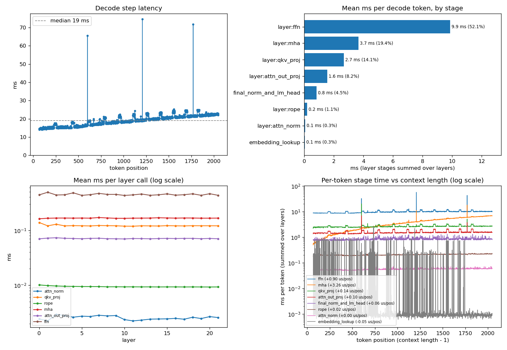

# nanoinfer

> **Big models. Tiny footprint. Zero dependencies.**

`nanoinfer` is a bare-metal, pure C++ LLM inference engine and GGUF parser built from first principles. It loads multi-gigabyte models directly from disk via memory-mapping (`mmap`), parses raw GGUF binary formats, and executes custom quantization kernels with zero external libraries.

---

## Features

- **Zero External Dependencies**: Built entirely with standard C++17 and POSIX system calls (`mmap`, `munmap`). No PyTorch, no llama.cpp, no third-party runtimes.
- **Zero-Copy Memory-Mapped I/O**: Maps model weights directly into virtual memory. Instant startup time and minimal RAM overhead even for large models.
- **Full GGUF v2/v3 Parser**:
  - Binary header and magic number validation
  - Arbitrary metadata key-value parser (strings, arrays, integers, floats, booleans)
  - Tensor directory extraction with dimension and byte offset calculation
- **Custom Dequantization Kernels**:
  - **`Q8_0`**: 32-weight blocks with 16-bit float scales (~3.7× compression vs. F32)
  - **`Q4_K`**: 256-weight super-blocks with packed sub-block scales and 4-bit nibbles (~7× compression vs. F32)
  - **`F16` to `F32`**: Bitwise IEEE 754 half-precision float expansion

---

## Project Structure

```text
nanoinfer/
├── model_loader.h      # GGUF header, tensor structures, and model loading API
├── model_loader.cpp    # mmap file loading, metadata parsing, tensor indexer
├── dequant.h           # Block structures (BlockQ8_0, BlockQ4_K) and dequant signatures
├── dequant.cpp         # Bit-manipulation and scale expansion routines
├── model_test.cpp      # Verification CLI for tensor inspection & dequant testing
├── Makefile            # Build configuration (clang++ -O3)
└── .gitignore
```

---

## Getting Started

### Prerequisites

A modern C++ compiler supporting C++17 (e.g. `clang++` or `g++`) and `make`.

### Build

```bash
make
```

This compiles the `model_test` binary with `-O3` optimizations.

### Run

Point the binary to any GGUF model file:

```bash
./model_test path/to/model.gguf
```

Example output:
```text
=== GGUF Header ===
magic:               0x46554747 (GGUF)
version:             3
tensor_count:        291
metadata_kv_count:   24

--- F32 tensor: blk.0.attn_norm.weight ---
first 5 values (direct, no dequant needed): 0.402344 0.380859 0.412109 ...

--- Q4_K tensor: blk.0.attn_q.weight ---
dims: [4096, 4096]
first 10 dequantized weights: -0.012451 0.003906 -0.021484 ...
```

---

## Performance & Benchmarks

Measured on Apple Silicon (Apple M3, ARM NEON SDOT `vdotq_s32`, dynamic work-stealing thread pool, 6 threads) running **TinyLlama 1.1B (`Q4_K_M`)** across the full **2,048 context window** (66 prefill tokens, 1,982 decode tokens generated):

- **Average Decode Latency:** **~18.9 ms/token** (**~52.8 tokens/sec**) average across the entire context window (down from **1041 ms/token** naive baseline — **~55× speedup**).
- **Graceful Context Scaling:** Latency stays flat and responsive, scaling from **14.4 ms/token** (69.4 tok/s) at position 100 to **21.8 ms/token** (45.8 tok/s) at position 1,980.
- **Fused Multithreaded NEON Attention:** Multi-head attention (MHA) across all 22 layers takes only **6.54 ms** total at position 1,980 (down from **34.4 ms** unvectorized single-threaded baseline — **~5.3× speedup**).
- **DRAM Traffic per Token:** **0 GB** (fused in-register quantized GEMV).

### Profiling Analysis (1,982 Decode Tokens across 2,048 Context)



### Breakdown by Component (averaged over 1,982 decode tokens from `probe.csv`)

| Component / Stage | Phase | Samples | Mean | p50 | p99 | Notes |
| :--- | :--- | :--- | :--- | :--- | :--- | :--- |
| `decode:forward_token` | `decode` | 1,982 | **18.94 ms** | **18.94 ms** | 24.61 ms | Full per-token decode step (~52.8 tok/s avg) |
| `all_layers` | `decode` | 1,982 | **18.04 ms** | **18.00 ms** | 23.62 ms | 22 transformer layers combined |
| ├── `layer:ffn` | `decode` | 43,604 | **0.45 ms** | **0.43 ms** | 0.63 ms | SwiGLU FFN (`Q4_K` / `Q6_K` SDOT kernels) |
| ├── `layer:mha` | `decode` | 43,604 | **0.17 ms** | **0.16 ms** | 0.33 ms | Fused NEON multi-head attention across 32 heads |
| ├── `layer:qkv_proj` | `decode` | 43,604 | **0.12 ms** | **0.12 ms** | 0.17 ms | Q, K, V projections |
| ├── `layer:attn_out_proj` | `decode` | 43,604 | **0.07 ms** | **0.07 ms** | 0.11 ms | Attention output projection |
| ├── `layer:rope` | `decode` | 43,604 | **0.009 ms** | **0.009 ms** | 0.011 ms | Rotary Position Embeddings |
| └── `layer:attn_norm` | `decode` | 43,604 | **0.003 ms** | **0.002 ms** | 0.004 ms | RMSNorm |
| `final_norm_and_lm_head`| `decode` | 1,982 | **0.85 ms** | **0.83 ms** | 1.16 ms | RMSNorm + Vocab projection (`Q6_K` SDOT) |
| `embedding_lookup` | `decode` | 1,982 | **0.05 ms** | **0.001 ms** | 0.86 ms | Single-row dequantization |
| `decode:argmax` | `decode` | 1,983 | **0.02 ms** | **0.02 ms** | 0.08 ms | Greedy token sampling |

### Latency Scaling with Context Length

| Token Position | Decode Latency | Throughput | 22-Layer MHA Total |
| :--- | :--- | :--- | :--- |
| `pos = 100` | **14.42 ms** | **69.4 tok/s** | 0.60 ms (0.027 ms/layer) |
| `pos = 500` | **15.55 ms** | **64.3 tok/s** | 1.84 ms (0.083 ms/layer) |
| `pos = 1000` | **18.20 ms** | **55.0 tok/s** | 3.31 ms (0.150 ms/layer) |
| `pos = 1500` | **20.68 ms** | **48.4 tok/s** | 5.07 ms (0.231 ms/layer) |
| `pos = 1980` | **21.83 ms** | **45.8 tok/s** | 6.54 ms (0.297 ms/layer) |

To reproduce these metrics and generate the plots on your machine:
```bash
# Run 2,000 token generation with long-context story prompt
NANO_IGNORE_EOS=1 NANO_PROMPT_FILE=prompt_long.txt NANO_N=2000 ./model_test ../llama.cpp/models/tinyllama.gguf

# Plot the probe results
python3 tools/plot_probe.py probe.csv -o probe.png
```

---

## Roadmap

- [x] Fast GGUF binary parser with `mmap`
- [x] Custom dequantization routines (`Q8_0`, `Q4_K`, `Q6_K`, `F16`)
- [x] Attention mechanism (GQA), RoPE, and KV Cache
- [x] Tokenizer (SentencePiece / BPE)
- [x] End-to-end autoregressive text generation
- [x] Single-row embedding lookup optimization (20.5 ms -> 0.09 ms)
- [x] ARM NEON SDOT (`vdotq_s32`) fused quantized GEMV for `Q4_K` and `Q6_K`
- [x] Fused `gate` + `up` GEMVs (saving 22 thread sync barriers per token)
- [x] Dynamic atomic work-stealing thread pool with QoS across heterogeneous cores
- [x] Fused multithreaded NEON Multi-Head Attention kernel (`mha_decode`)
- [ ] Multi-row register blocking (2-row SDOT)
- [ ] Pipeline parallelism over TCP sockets

---

## License

MIT
