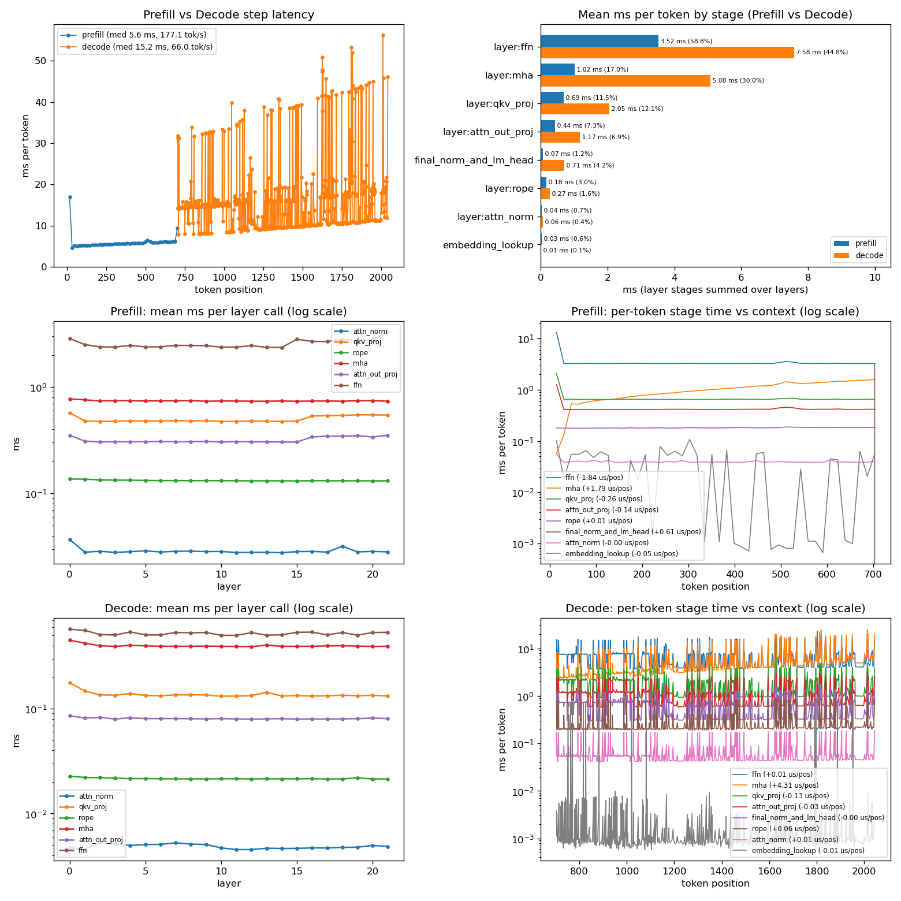

# nanoinfer

> **Big models. Tiny footprint. Zero dependencies.**

`nanoinfer` is a bare-metal, pure C++ LLM inference engine and GGUF parser built from first principles. It loads multi-gigabyte models directly from disk via memory-mapping (`mmap`), parses raw GGUF binary formats, and executes custom quantization kernels with zero external libraries.

---

## Features

- **Zero External Dependencies**: Built entirely with standard C++17 and POSIX system calls (`mmap`, `munmap`). No PyTorch, no llama.cpp, no third-party runtimes.
- **Zero-Copy Memory-Mapped I/O**: Maps model weights directly into virtual memory. Instant startup time and minimal RAM overhead even for large models.
- **Full GGUF v2/v3 Parser**:
  - Binary header and magic number validation
  - Arbitrary metadata key-value parser (strings, arrays, integers, floats, booleans)
  - Tensor directory extraction with dimension and byte offset calculation
- **Custom Dequantization Kernels**:
  - **`Q8_0`**: 32-weight blocks with 16-bit float scales (~3.7× compression vs. F32)
  - **`Q4_K`**: 256-weight super-blocks with packed sub-block scales and 4-bit nibbles (~7× compression vs. F32)
  - **`F16` to `F32`**: Bitwise IEEE 754 half-precision float expansion

---

## Project Structure

```text
nanoinfer/
├── model_loader.h      # GGUF header, tensor structures, and model loading API
├── model_loader.cpp    # mmap file loading, metadata parsing, tensor indexer
├── dequant.h           # Block structures (BlockQ8_0, BlockQ4_K) and dequant signatures
├── dequant.cpp         # Bit-manipulation and scale expansion routines
├── model_test.cpp      # Verification CLI for tensor inspection & dequant testing
├── Makefile            # Build configuration (clang++ -O3)
└── .gitignore
```

---

## Getting Started

### Prerequisites

A modern C++ compiler supporting C++17 (e.g. `clang++` or `g++`) and `make`.

### Build

```bash
make
```

This compiles the `model_test` binary with `-O3` optimizations.

### Run

Point the binary to any GGUF model file:

```bash
./model_test path/to/model.gguf
```

Example output:
```text
=== GGUF Header ===
magic:               0x46554747 (GGUF)
version:             3
tensor_count:        291
metadata_kv_count:   24

--- F32 tensor: blk.0.attn_norm.weight ---
first 5 values (direct, no dequant needed): 0.402344 0.380859 0.412109 ...

--- Q4_K tensor: blk.0.attn_q.weight ---
dims: [4096, 4096]
first 10 dequantized weights: -0.012451 0.003906 -0.021484 ...
```

---

## Performance & Benchmarks

Measured on Apple Silicon (Apple M3, ARM NEON SDOT `vdotq_s32`, dynamic work-stealing thread pool, 6 threads) running **TinyLlama 1.1B (`Q4_K_M`)** across the full **2,048 context window** (`prompts/prompt_code_500.txt`: 704 prefill tokens in batches of $B=16$, followed by 1,344 decode tokens generated with 3-gram speculative decoding $B \le 4$):

- **Batched Prefill Throughput:** **~6.05 ms/token** effective (**~165.4 tokens/sec**, `4,257 ms` total across 44 chunks of $B=16$, `91.34 ms` p50 chunk latency = **5.71 ms/tok** p50) using 4-token register-blocked NEON GEMM (`matmul_q4_k` / `matmul_q6_k`), achieving up to **~458 GFLOP/s** and a **~2.5× speedup** over sequential single-token prefill.
- **Speculative Decode Latency (`NANO_SPEC_K=3`, $B \le 4$):**
  - On `prompts/prompt_code_500.txt` (1,344 decode tokens): **14.05 ms/emitted_tok** (**71.2 tokens/sec**, `18,880 ms` across 711 steps vs. `22,814 ms` / `16.98 ms/tok` at $B=1$; **68.5% draft acceptance**, `1.89 tok/step`, `11.55 ms/hw_tok`, `82.2%` useful hardware work).
  - On `prompts/prompt_500.txt` (1,399 decode tokens): **11.34 ms/emitted_tok** (**88.2 tokens/sec**, `15,862 ms` across 440 steps vs. `23,005 ms` / `16.44 ms/tok` at $B=1$; **81.9% draft acceptance**, `3.18 tok/step` — **1.45× speedup** over $B=1$ and **~91× speedup** over the `1041 ms/tok` naive baseline).
- **100% Mathematical Greedy Token Parity:** Speculative verification produces bit-for-bit identical token IDs (`0` diff) against standard $B=1$ autoregressive decoding across the full 2,048 context window.
- **DRAM Allocation per Token:** **0 bytes** (fused in-register quantized GEMV / GEMM).

### Profiling Analysis (704 Prefill Tokens + 1,344 Speculative Decode Tokens across 2,048 Context)



### Per-Emitted-Token Stage Breakdown: Prefill ($B=16$, 704 tokens) vs. Speculative Decode ($B \le 4$, 1,344 emitted tokens / 711 steps)

| Stage (summed over 22 layers) | Prefill (`ms/tok`) | Prefill Share | Spec Decode (`ms/tok`) | Decode Share | Notes |
| :--- | :---: | :---: | :---: | :---: | :--- |
| `layer:ffn` (SwiGLU `Q4_K` / `Q6_K`) | **3.61 ms** | 59.8% | **6.05 ms** | 43.1% | Reduced from `8.30 ms/tok` at $B=1$ via 4-token weight reuse |
| `layer:mha` (Causal NEON GQA) | **1.03 ms** | 17.1% | **4.64 ms** | 33.1% | Evaluates all `1,635` hardware tokens over `float32` KV cache |
| `layer:qkv_proj` (`Q4_K` / `Q6_K`) | **0.71 ms** | 11.8% | **1.57 ms** | 11.1% | Reduced from `2.29 ms/tok` at $B=1$ |
| `layer:attn_out_proj` (`Q4_K`) | **0.45 ms** | 7.5% | **0.94 ms** | 6.7% | Reduced from `1.26 ms/tok` at $B=1$ |
| `final_norm_and_lm_head` (`Q6_K`) | **0.002 ms** | 0.0% | **0.53 ms** | 3.8% | Reduced from `0.80 ms/tok` at $B=1$ (`matmul_tensor`) |
| `layer:rope` | **0.18 ms** | 3.0% | **0.25 ms** | 1.8% | Rotary Position Embeddings |
| `layer:attn_norm` | **0.04 ms** | 0.7% | **0.06 ms** | 0.4% | RMSNorm |
| `embedding_lookup` | **0.01 ms** | 0.1% | **0.001 ms** | 0.0% | Single-row dequantization |
| **Total Effective (`total_ms / emitted_tokens`)** | **6.05 ms/tok** | **165.4 tok/s** | **14.05 ms/tok** | **71.2 tok/s** | `11.55 ms/hw_tok` across `1,635` hardware tokens (`82.2%` useful) |

### Raw Probe Summary (from `probe.csv`)

| Component / Stage | Phase | Samples | Total (`ms`) | Mean (`ms`) | p50 (`ms`) | p99 (`ms`) | Notes |
| :--- | :--- | :--- | :--- | :--- | :--- | :--- | :--- |
| `prefill_total` | `prefill` | 1 | **4257.34 ms** | **4257.34 ms** | **4257.34 ms** | 4257.34 ms | Full 704-token prompt prefill (`6.05 ms/tok` eff) |
| `prefill:forward_token` | `prefill` | 44 | **4257.34 ms** | **96.76 ms** | **91.34 ms** | 207.31 ms | Per 16-token prefill batch (~175.2 tok/s p50) |
| `decode:forward_token` | `decode` | 711 | **18880.41 ms** | **26.56 ms** | **17.61 ms** | 46.84 ms | 711 steps emitting 1,344 tokens (`14.05 ms/tok` eff) |
| `all_layers` | `decode` | 711 | **18160.87 ms** | **25.54 ms** | **16.85 ms** | 45.33 ms | 22 transformer layers combined ($B \in \{1..4\}$) |
| ├── `layer:ffn` | `decode` | 15,642 | **8130.47 ms** | **0.520 ms** | **0.375 ms** | 0.894 ms | SwiGLU FFN (`Q4_K` / `Q6_K` SDOT GEMV/GEMM) |
| ├── `layer:mha` | `decode` | 15,642 | **6242.80 ms** | **0.399 ms** | **0.258 ms** | 0.982 ms | Fused NEON multi-head attention across 32 heads |
| ├── `layer:qkv_proj` | `decode` | 15,642 | **2104.36 ms** | **0.135 ms** | **0.111 ms** | 0.244 ms | Q, K, V projections |
| ├── `layer:attn_out_proj` | `decode` | 15,642 | **1265.07 ms** | **0.081 ms** | **0.061 ms** | 0.150 ms | Attention output projection |
| ├── `layer:rope` | `decode` | 15,642 | **338.66 ms** | **0.022 ms** | **0.010 ms** | 0.042 ms | Rotary Position Embeddings |
| └── `layer:attn_norm` | `decode` | 15,642 | **75.12 ms** | **0.005 ms** | **0.003 ms** | 0.009 ms | RMSNorm |
| `final_norm_and_lm_head`| `decode` | 711 | **716.89 ms** | **1.008 ms** | **0.799 ms** | 1.604 ms | Batch RMSNorm + Vocab projection (`Q6_K` SDOT) |
| `embedding_lookup` | `decode` | 711 | **1.78 ms** | **0.002 ms** | **0.003 ms** | 0.007 ms | Batch single-row dequantization |
| `decode:argmax` | `decode` | 1,345 | **57.57 ms** | **0.043 ms** | **0.021 ms** | 0.123 ms | Greedy token verification |

### Work Done (`batch_tokens`) vs. Meaningful Work (`emitted_tokens`)

| Benchmark Prompt | Prompt / Decode | Steps | Hardware Tokens ($B$) | Emitted Tokens ($E$) | Draft Acceptance | `ms / hw_tok` | Effective `ms / tok` | Effective Throughput |
| :--- | :---: | :---: | :---: | :---: | :---: | :---: | :---: | :---: |
| `prompts/prompt_code_500.txt` | 704 / 1,344 | 711 | 1,635 | 1,344 (82.2% useful) | **68.5%** (633 / 924) | 11.55 ms | **14.05 ms/tok** | **71.2 tok/s** |
| `prompts/prompt_500.txt` | 649 / 1,399 | 440 | 1,558 | 1,399 (89.8% useful) | **81.9%** (959 / 1,118) | 10.18 ms | **11.34 ms/tok** | **88.2 tok/s** |

To reproduce these metrics and generate the plots on your machine:
```bash
# Run full 2,048-context generation with the 704-token C++ systems prompt
NANO_IGNORE_EOS=1 NANO_PROMPT_FILE=prompts/prompt_code_500.txt NANO_N=2000 ./model_test ../llama.cpp/models/tinyllama.gguf

# Plot both prefill and decode probe results side-by-side
python3 tools/plot_probe.py probe.csv --phase both -o probe.png

# Benchmark batched prefill across B in {1, 2, 4, 8, 16, 32, 64}
python3 tools/bench_prefill.py -m ../llama.cpp/models/tinyllama.gguf
```

---

## Roadmap

- [x] Fast GGUF binary parser with `mmap`
- [x] Custom dequantization routines (`Q8_0`, `Q4_K`, `Q6_K`, `F16`)
- [x] Attention mechanism (GQA), RoPE, and KV Cache
- [x] Tokenizer (SentencePiece / BPE)
- [x] End-to-end autoregressive text generation
- [x] Single-row embedding lookup optimization (20.5 ms -> 0.09 ms)
- [x] ARM NEON SDOT (`vdotq_s32`) fused quantized GEMV for `Q4_K` and `Q6_K`
- [x] In-register NEON scale accumulation (1 horizontal `vaddvq_s32` reduction per 256-weight super-block)
- [x] Fused `gate` + `up` projections (saving 22 thread sync barriers per step)
- [x] Dynamic atomic work-stealing thread pool with QoS across heterogeneous cores
- [x] Fused multithreaded NEON Multi-Head Attention kernel (`mha_decode`)
- [x] 4-token activation register-blocked NEON GEMM (`matmul_q4_k`, `matmul_q6_k`) and batched `forward_batch` prefill
- [x] Speculative decoding (3-Gram Prompt-Lookup drafting with $B=4$ parallel verification + `batch_tokens`/`emitted_tokens` telemetry)
- [ ] `Q8_0` quantized KV cache
- [ ] Pipeline parallelism over TCP sockets

---

## License

MIT
